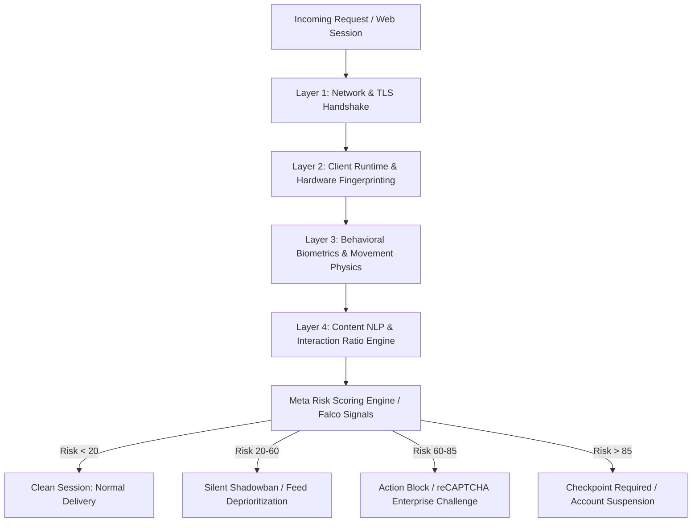

# 🕵️ How Instagram Detects Bots & Automated Accounts (2025–2026 Deep Technical Research)

> **A Comprehensive Engineering Analysis of Meta's Anti-Fraud Infrastructure, Client Fingerprinting, Behavioral Heuristics, CDP Detection, and Evasion Countermeasures.**

---

## 📑 Table of Contents
1. [Executive Summary & The 2024–2026 Paradigm Shift](#1-executive-summary--the-20242026-paradigm-shift)
2. [Layer 1: Network, TLS & Transport Fingerprinting](#2-layer-1-network-tls--transport-fingerprinting)
3. [Layer 2: Browser Environment & CDP (Chrome DevTools Protocol) Leaks](#3-layer-2-browser-environment--cdp-chrome-devtools-protocol-leaks)
4. [Layer 3: Behavioral Biometrics & Mathematical Entropy](#4-layer-3-behavioral-biometrics--mathematical-entropy)
5. [Layer 4: Social Graph, Content Semantics & Interaction Ratios](#5-layer-4-social-graph-content-semantics--interaction-ratios)
6. [Layer 5: Account Maturity, Trust Scores & Cold Starts](#6-layer-5-account-maturity-trust-scores--cold-starts)
7. [The Enforcement Ladder: How Instagram Penalizes Accounts](#7-the-enforcement-ladder-how-instagram-penalizes-accounts)
8. [Case Study: Why Older Bots Failed & What Survives Today](#8-case-study-why-older-bots-failed--what-survives-today)
9. [Engineering Blueprint: How Our Architecture Mitigates Flags](#9-engineering-blueprint-how-our-architecture-mitigates-flags)

---

## 1. Executive Summary & The 2024–2026 Paradigm Shift

Over the last two years, Meta (Instagram) has overhauled its anti-bot and fraud-detection architecture. Traditional automation techniques—such as Selenium wrappers, standalone Python `requests`/`aiohttp` scripts, Android emulators (BlueStacks, LDPlayer), Appium mobile testing rigs, and naive Chrome extensions—are now **near-instant death sentences** for Instagram accounts.

### The Modern Defense Triad
Meta does not rely on a single check. Instead, incoming telemetry passes through an asynchronous **Defense Triad**:



Meta aggregates hundreds of micro-signals into a dynamic **Trust Score** assigned to every active device, IP address, and account session. If the score degrades below a threshold, automated defenses trigger.

---

## 2. Layer 1: Network, TLS & Transport Fingerprinting

Before JavaScript even executes or a single cookie is validated, Meta's edge servers analyze the lower levels of the network stack.

### A. IP Quality & ASN Classification
Meta inspects the Autonomous System Number (ASN) and IP type via IP intelligence databases (IP2Location, MaxMind, spur.us):
- **Datacenter IPs (AWS, GCP, DigitalOcean, Hetzner, Linode):** Instant flag. Instagram expects residential or cellular connections. An account logging in from an AWS IP is marked as untrusted immediately.
- **VPNs & Commercial Proxies:** Public VPN subnets have high connection velocities across thousands of users, triggering immediate verification challenges.
- **Residential & 4G/5G Mobile Proxies:** Mobile carrier IPs (CGNAT) are shared by thousands of real phone users simultaneously. Meta cannot ban a mobile subnet without collateral damage, making high-quality mobile proxies the most trusted network vector.

### B. TLS Handshake Fingerprinting (JA3 / JA4)
When a browser establishes an HTTPS connection, it sends a `ClientHello` packet containing:
1. TLS version
2. Supported Cipher Suites (order and choice)
3. Supported Extensions
4. Elliptic Curves and Point Formats

```
JA3 Hash = MD5(TLSVersion,CipherSuites,Extensions,EllipticCurves,EllipticCurvePointFormats)
```
- Standard Python HTTP clients (`requests`, `urllib`, `httpx`) generate distinct JA3 signatures completely different from consumer browsers.
- Stock Playwright Chromium compiled by Microsoft often has slight cipher order variances compared to production consumer Google Chrome.
- **If your User-Agent claims to be Chrome on Windows, but your JA3 fingerprint matches a Linux server binary or Node.js runtime, you are flagged at the edge layer.**

### C. HTTP/2 & HTTP/3 Frame Fingerprinting (Akamai / Meta Edge)
Meta examines HTTP/2 stream settings:
- Initial Window Size
- Max Concurrent Streams
- Header pseudo-header ordering (`:method`, `:path`, `:authority`, `:scheme`)
- Header priority frame settings

Browsers have rigid HTTP/2 frame signatures that automation libraries frequently scramble.

---

## 3. Layer 2: Browser Environment & CDP (Chrome DevTools Protocol) Leaks

When automation tools like Playwright or Puppeteer drive a browser, they interact via the **Chrome DevTools Protocol (CDP)**. Modern anti-fraud scripts (including Meta's client-side telemetry modules) actively scan for CDP artifacts.

### A. The `navigator.webdriver` Property
By default, automation frameworks set:
```javascript
navigator.webdriver === true
```
While simple stealth scripts attempt to override this with `Object.defineProperty()`, amateur stealth patches leave telltale signs:
```javascript
// Native property is non-configurable:
Object.getOwnPropertyDescriptor(navigator, 'webdriver').configurable === false;
// Bot patch mistake:
Object.getOwnPropertyDescriptor(navigator, 'webdriver').configurable === true; // FLAGGED!
```

### B. CDP Protocol Hooks & `Runtime.enable`
When Playwright connects via CDP, internal runtime hooks are enabled:
1. **Timing Artifacts:** CDP execution introduces microsecond timing discrepancies in JavaScript execution loops.
2. **Exception Stack Traces:** Errors thrown inside CDP-evaluated functions often leak strings like `at eval (eval at <anonymous>)` or references to automation wrappers.
3. **`_inspector` & DevTools APIs:** Meta's client scripts check `window.chrome` properties, `Function.prototype.toString`, and prototype chain fidelity.

### C. WebGL & GPU Hardware Fingerprinting
Headless browsers often default to software rasterization:
- **Renderer:** `SwiftShader`, `Mesa`, `llvmpipe` (Instant Bot Flag!)
- **Real Consumer Hardware:** `ANGLE (NVIDIA GeForce RTX 4070 Direct3D11 vs_5_0 ps_5_0)`, `Intel Iris Xe`, `Apple M2 GPU`
- Meta extracts WebGL shader precision numbers, Canvas 2D image hashing (rendered text sub-pixel anti-aliasing differs per GPU and OS font engine), and Web Audio API frequency curves.

### D. AudioContext & Sensor Telemetry
Mobile apps inspect hardware gyroscope and accelerometer data. Desktop web browsers are evaluated for screen coordinates:
```javascript
window.screen.availWidth !== window.innerWidth // Headless mismatch
window.screen.colorDepth !== 24
```

---

## 4. Layer 3: Behavioral Biometrics & Mathematical Entropy

This is where Meta's machine learning classifiers (trained on billions of human interactions) operate. Humans are noisy, erratic, and mathematically unpredictable; bots are uniform, precise, and linear.

### A. Mouse Movement Physics & Trajectory
| Human Mouse Movement | Bot Emulation (Flawed) |
| :--- | :--- |
| **Bézier Curves**: Natural curved paths with varying velocity. | **Linear Teleportation**: Coordinates jump directly between points `(x1, y1) -> (x2, y2)`. |
| **Acceleration & Deceleration**: Muscle movement starts slow, speeds up, and slows down near the target. | **Constant Speed**: Linear time/distance ratio. |
| **Target Overshoot & Correction**: Humans often miss an element by a few pixels and nudge back. | **Pixel-Perfect Accuracy**: Clicks land dead-center on elements every single time. |
| **Micro-Jitter & Tremors**: Continuous tiny variations even when holding a mouse. | **Dead Silence**: Zero coordinate change during idle delays. |

### B. Keystroke Cadence & Typing Dynamics
- **Robot Typing:** Calling `.fill("Hello World")` sets the input value in a single microsecond DOM mutation.
- **Amateur Bot Typing:** Inserting characters with a fixed delay (e.g., exactly `50ms` per key) creates an unnatural, mathematically flat distribution.
- **Human Typing:** Follows a **Gaussian / Normal distribution** (varying between 30ms and 180ms per key), with longer pauses before capital letters, symbols, or spacebars, and occasional backspaces/corrections.

### C. Mathematical Velocity & Action Entropy
- **Fixed Interval Decay:** If an account performs an action every 30.00 seconds, Meta's time-series anomaly detection flags the account within 5 to 10 cycles.
- **Session Duration & Fatigue:** Real humans do not browse Instagram for 8 continuous hours without breaks. A human uses the app for 10–25 minutes, leaves for an hour, returns, etc.

---

## 5. Layer 4: Social Graph, Content Semantics & Interaction Ratios

Meta's anti-spam engine inspects what you say, who you talk to, and your behavioral balance.

### A. The "Outbound vs. Inbound" Ratio
This is one of the most critical heuristics:
- **Normal Human User:**
  - 85% to 90% of time spent **consuming content** (scrolling feed, watching Reels, viewing Stories, reading comments).
  - 10% to 15% of time spent on **outbound actions** (leaving a comment, liking a post, sending a message).
- **Bot Behavior:**
  - 0% time spent watching videos.
  - 95% time spent on direct navigations, opening comment sections, clicking profiles, and sending DMs.
  - **Result:** High outbound-to-inbound ratio flags the account as an automated outreach tool.

### B. Natural Language Processing (NLP) & Semantic Hashing
Meta runs comment and DM text through internal semantic classifiers:
1. **Duplicate Text Hashing:** Sending the exact same message to 10 different people within an hour trips spam filters instantly.
2. **Near-Duplicate Detection (Levenshtein Distance & Embedding Similarity):** Merely swapping a synonym in a robotic template (`"Hey [Name], loved your comment!"` vs `"Hi [Name], loved your remark!"`) still maps to identical vector embeddings in modern LLM classifiers.
3. **Engagement-Bait Keyword Scans:** Direct regex and transformer filters actively scan for:
   - Story checks: `"story dekho"`, `"check my story"`, `"ek bar story chek kro"`
   - Profile checks: `"mera profile dekho"`, `"check my bio"`, `"visit my page"`
   - Follow loops: `"f4f"`, `"follow back"`, `"follow me"`

### C. Unsolicited Cold Outreach vs. Engaged Conversing
- **High-Risk (Cold Outreach):** Scraping a competitor’s follower list and sending cold DMs to people who have never interacted with you. Result: Users click "Report Spam" or "Block", causing Meta's algorithm to immediately ban the outreach account.
- **Low-Risk (Engaged Reply):** Replying to someone who **voluntarily commented on your own Reel**. The user initiated the engagement; therefore, a personalized reply is contextually expected and has a near-zero report rate.

---

## 6. Layer 5: Account Maturity, Trust Scores & Cold Starts

Every Instagram account has an internal **Trust Score** influenced by:

```
Trust Score = f(Account Age, 2FA Status, Historical Activity, IP Stability, Report History)
```

1. **The "Fresh Account" Trap:**
   - A brand new account (< 30 days old) has minimal trust capital. If a new account sends 20 DMs on day one, it is instantly blocked.
   - Warmed-up accounts (6+ months old, active daily human browsing, authenticated phone number, 2FA active) have substantially higher rate limit allowances.
2. **Cold-Start Browser Profiles:**
   - Launching a browser with a blank profile (no cached cookies, empty `IndexedDB`, zero `localStorage`, empty Chrome browsing history) raises suspicion.
   - Genuine user profiles carry persistent session tokens, local storage caches, and established Google/Meta session IDs.

---

## 7. The Enforcement Ladder: How Instagram Penalizes Accounts

When Meta's algorithms detect anomalies, punishment follows a progressive escalation:

```
[Level 1: Silent Shadowban]
  ↳ Organic reach drops; content hidden from Explore & hashtag feeds.
         ↓
[Level 2: Soft Action Block (HTTP 429 / Policy Error)]
  ↳ "We restrict certain activity to protect our community." 
  ↳ Specific action (like, follow, DM) disabled for 24-72 hours.
         ↓
[Level 3: Security Checkpoints & CAPTCHA]
  ↳ Forced reCAPTCHA Enterprise challenge.
  ↳ SMS OTP verification or email confirmation.
         ↓
[Level 4: Suspicious Login / Forced Password Reset]
  ↳ Session revoked; user must re-authenticate and verify identity.
         ↓
[Level 5: Selfie Video / Identity Verification]
  ↳ User must upload a video selfie turning their head in multiple angles.
         ↓
[Level 6: Permanent Suspension (180-Day Appeal)]
  ↳ Account disabled. Device hardware ID & IP subnet blacklisted.
```

---

## 8. Case Study: Why Older Bots Failed & What Survives Today

### ❌ What Was Banned into Extinction:
1. **Private API Emulators (e.g., Python `instagram-private-api`):** Meta updated its internal mobile app encryption (signing requests with proprietary HMAC signatures and device-specific cryptographic keys). Reverse-engineered API wrappers cannot keep up and leak invalid headers.
2. **Android Emulators (BlueStacks / LDPlayer / Nox):** Mobile apps inspect hardware sensors (absence of accelerometer jitter, generic VM CPU strings like `QEMU Virtual CPU`).
3. **Raw Selenium / Standalone Playwright Chromium:** Caught by JA3/TLS mismatch, WebGL software rendering, and exposed CDP hooks.

### ✅ What Survives in 2025–2026:
1. **Real Hardware Mobile Devices (Phone Farms):** Physical Android devices connected via ADB or USB hardware rigs, physically touching real screens on 4G/5G mobile carriers.
2. **CDP Attachment to Real Consumer Chrome Profiles (Our Approach):**
   - Running the actual installed Google Chrome browser on a real PC.
   - Reusing the user's authentic desktop profile with established history and cookies.
   - Leveraging genuine native GPU drivers (Direct3D / Metal) and production TLS/JA3 handshakes.
   - Human-in-the-loop fallback when security checkpoints arise.

---

## 9. Engineering Blueprint: How Our Architecture Mitigates Flags

Our project (`instagram-reels-autopilot`) was specifically engineered around these modern anti-bot heuristics:

| Threat Vector | Meta Heuristic | Our Architectural Defense |
| :--- | :--- | :--- |
| **TLS / JA3 Signature** | Detects non-Chrome TLS handshakes. | **Attaches to installed Google Chrome** via CDP port 9222. The TLS handshake originates directly from the official Google Chrome binary. |
| **Browser Fingerprinting** | Identifies headless artifacts and software GPUs. | **Headful Chrome Execution** with the user's dedicated profile (`session_data/chrome_profile`). Uses native GPU acceleration, authentic screen resolution, and real hardware parameters. |
| **CDP Leakage** | Detects remote automation hooks. | Uses `--disable-blink-features=AutomationControlled` and clean execution flags. Avoids heavy synthetic DOM script injections. |
| **Feed Navigation Loops** | Detects keyboard shortcut spam. | **Viewport-level Mouse Wheel Scrolling (`mouse.wheel`)**: Simulates natural finger swipes down 90% of screen height with deceleration nudges. |
| **Typing Detection** | Flags instant DOM value population. | **Character-by-Character Typing** with natural delays (30–45ms per keystroke) rather than raw value assignment. |
| **Semantic Spam Filters** | Identifies repetitive message templates. | **Multi-Model LLM Dynamic Generation**: 3-stage human message sequence. Message 1 anchors to their exact comment; Message 2 creates a hyper-personalized question; Message 3 has 50% random variation; zero corporate clichés. |
| **Spam / Bait Commenters** | Flags accounts interacting with spam bots. | **Multi-Layer Regex Filters**: Automatically filters out Hinglish & English engagement bait (`"story dekho"`, `"check bio"`, `"f4f"`). |
| **Outbound Ratio Imbalance** | Flags 100% outbound action spammers. | **Engaged-Only Mode**: Only evaluates commenters who voluntarily interacted with our own Reel. Never scrapes or spams random profiles. |
| **Rate Limit Clamps** | Triggers 24-hour action blocks. | **Configurable Cooldowns & Session Capping**: Debounce delays (3.5s+), max comments per reel (25), max profiles per session (100). |
| **Security Checkpoints** | reCAPTCHA Enterprise / Challenge. | **Watchdog Pause System**: Automatically detects CAPTCHA / checkpoint URLs, sounds an audible alert (`\a`), and yields full manual control to the operator until cleared. |

---

## 📚 References & Further Reading
- *Meta Threat Intelligence Reports on Inauthentic Behavior (2024–2025)*
- *Akamai & Cloudflare Bot Management TLS Fingerprint Whitepapers*
- *Playwright & CDP Detection Techniques (BrowserScan, Scrapfly, Castle.io Research)*
- *BlackHatWorld (BHW) & r/Instagram Developer Discussions on Mobile Proxy Infrastructure and Action Velocity Clamps*
