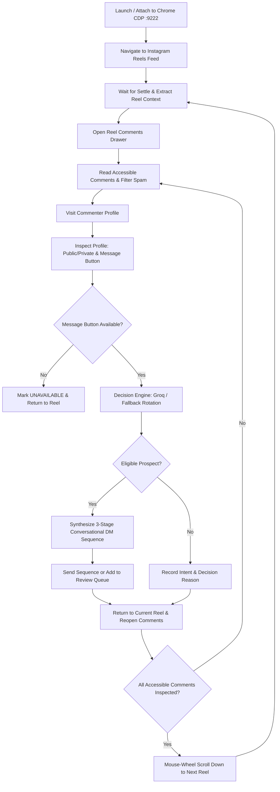

# 🚀 Instagram Reels Autopilot (`instagram-reels-autopilot`)

> **Autonomous Instagram Reels Investigation, Commenter Profiling, and AI-Powered Engagement Agent via Chrome CDP**

[](https://www.python.org/)
[](https://playwright.dev/)
[](https://groq.com/)
[](LICENSE)
[]()

---

## 📌 Executive Overview

**`instagram-reels-autopilot`** is a high-performance computer-use automation agent engineered to operate directly inside an authenticated Google Chrome session. It navigates Instagram Reels feeds, reads active comments, inspects commenter profiles one by one, classifies lead eligibility using multi-tiered AI decision models, and constructs authentic, human-like direct message conversations.

### 🌟 Why This Agent?
- **Zero Session Loss**: Attaches directly to your real Chrome profile via Chrome DevTools Protocol (CDP port 9222). Keeps your login, cookies, device fingerprints, and 2FA intact.
- **Multi-Model AI Rotation**: Powered by ultra-fast Groq inference (Qwen 3.8 27B, GPT-OSS, Llama 4, Gemma 2) with instant fallback rotation to OpenRouter, local Ollama, and deterministic rule engines.
- **Natural Human Navigation**: Employs genuine mouse-wheel scrolling across viewport heights to advance between Reels, preventing feed resets or infinite loops.
- **Intelligent Anti-Spam Filters**: Automatically filters out Hinglish and English engagement bait (e.g., "story dekho", "check my bio", "follow back", "f4f").
- **Meta Checkpoint Watchdog**: Detects security challenges and reCAPTCHA prompts, plays an audible alert, pauses safely, and automatically resumes once verified.

---

## 🏗️ Architecture & Operation Flow



---

## ⚡ Key Capabilities

### 1. 🤖 Multi-Tier AI Decision Engine
- **Primary Cloud Engine**: High-throughput Groq API running `qwen/qwen3.8-27b`, with automatic rotation across modern OSS models (`openai/gpt-oss-20b`, `meta-llama/llama-4-scout`, `llama-3.1-8b-instant`, `gemma2-9b-it`).
- **Secondary Cloud Fallback**: OpenRouter integration for Claude, GPT-4o, and Mistral models.
- **Local Air-Gapped Fallback**: Local Ollama support for private offline inference.
- **Deterministic Rule Engine**: Instant zero-API fallback ensures the agent never stops during network outages.

### 2. 💬 3-Stage Human Conversation Automata
Eligible leads receive naturally paced, ultra-personalized conversation sequences:
1. **Message 1 (The Anchor)**: Exact quote of the user's comment (clean text, no robotic formatting).
2. **Message 2 (Personalized Reaction & Question)**: A witty, hyper-personalized reaction under 25 words with strictly one question mark, matching the post context and language (English/Hinglish/slang).
3. **Message 3 (Optional Follow-Up)**: Contextual sign-off triggered at ~50% random probability for human variance.

### 3. 🛡️ Stealth & Anti-Detection Architecture
- Random jitter delays (`MIN_ACTION_DELAY` to `MAX_ACTION_DELAY`) between browser interactions.
- Natural character typing delay simulation (30–45ms per keystroke).
- Dedicated profile directory isolation prevents conflicts with personal Chrome windows.
- Automatic cleanup routines keep disk footprint light by auto-trimming CSV logs and purging temporary screenshots.

---

## 🚀 Quick Start Guide

### Step 1: Clone the Repository
```bash
git clone https://github.com/Hariprajwal/instagram-reels-autopilot.git
cd instagram-reels-autopilot
```

### Step 2: Install Dependencies
```bash
python -m venv venv
# Windows:
venv\Scripts\activate
# Linux/macOS:
source venv/bin/activate

pip install -r requirements.txt
playwright install chromium
```

### Step 3: Configure Environment
Copy `.env.example` to `.env`:
```bash
cp .env.example .env
```

Set your configuration values inside `.env`:
```ini
# Primary LLM API (Groq)
GROQ_API_KEY=gsk_your_groq_api_key_here
GROQ_MODEL=qwen/qwen3.8-27b

# Instagram Login Credentials (Optional - for auto-login)
INSTAGRAM_USERNAME=your_instagram_username
INSTAGRAM_PASSWORD=your_instagram_password

# Operating Modes
ELIGIBILITY_MODE=engaged       # 'engaged' (message all visible) or 'strict' (explicit DM consent only)
AUTO_NEXT_REEL=true            # Automatically scroll to next reel when comments finish
REEL_COOLDOWN_SECONDS=3.5      # Settle delay before scanning a reel
```

### Step 4: Run the Agent
```bash
python main.py
```

The agent will:
1. Check if Chrome is listening on port `9222`. If not, it automatically launches Chrome with remote debugging enabled.
2. Connect to the active Instagram tab.
3. Begin autonomous reel inspection, comment reading, profiling, and message dispatch.

---

## 📂 Project Structure

```
instagram-reels-autopilot/
├── config/
│   ├── settings.py             # Global Pydantic settings, paths, and timeouts
│   └── selectors.json          # Multi-layer fallback DOM selectors for Instagram
├── core/
│   ├── browser_controller.py   # CDP lifecycle, auto-launch, auto-login, checkpoint detector
│   ├── reel_detector.py        # Mouse-wheel reel navigation & viewport context extraction
│   ├── comment_reader.py       # Drawer interaction, comment parsing, and spam elimination
│   ├── profile_inspector.py    # Profile visitor, message button verification, DM sender
│   └── decision_engine.py      # Multi-model intent analysis and conversation generator
├── models/
│   ├── schemas.py              # Pydantic validation schemas
│   └── classifier.py           # Multi-model Groq rotation, OpenRouter, Ollama & rule engine
├── storage/
│   ├── session_logger.py       # Auto-trimming CSV session logger & metrics aggregator
│   └── state_manager.py        # Persistent JSON state cache with size caps
├── ui/
│   ├── dashboard.py            # Rich terminal dashboard and live analytics table
│   └── cli.py                  # Operator lead review queue terminal UI
├── session_data/               # Local cache, logs, and profile records (gitignored)
├── launch_chrome.bat           # 1-click Windows batch launcher for Chrome CDP
├── launch_chrome.ps1           # 1-click PowerShell launcher for Chrome CDP
├── test_sync.py                # Standalone scenario unit verification suite
└── main.py                     # Main execution loop
```

---

## 🧪 Testing & Verification

Run the scenario test suite to verify classification logic, spam filtering, and conversation generation without opening a browser:
```bash
python test_sync.py
```

---

## ⚖️ License & Commercial Monetization Terms

This project is licensed under the **Source-Available Non-Commercial & Commercial Royalty License**.

- **Non-Commercial Use**: Free for personal study, academic research, and non-commercial evaluation.
- **Commercial Use & Monetization**: Any commercial use, SaaS deployment, client outreach agency usage, or monetization of this software or its derivatives **requires a formal written Commercial License Agreement with Hariprajwal** and the payment of agreed licensing fees or royalties.

For commercial licensing inquiries or custom enterprise builds, contact:
**Hariprajwal** via [GitHub](https://github.com/Hariprajwal).

See the full [LICENSE](LICENSE) file for complete legal terms.
